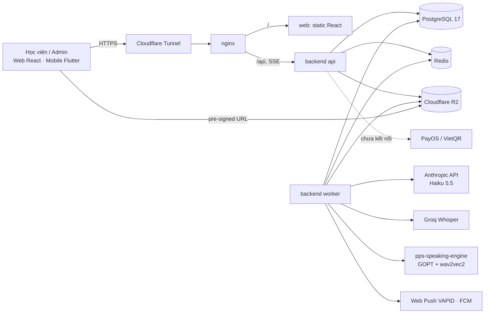
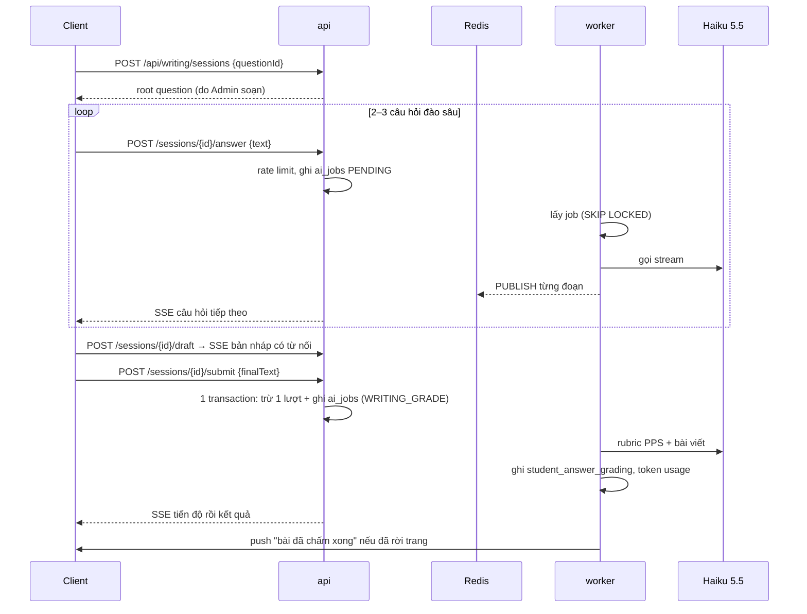
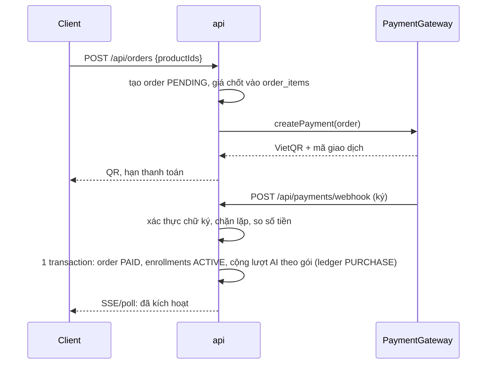

# Thiết kế hệ thống — PPS Smart English (MVP)

Tài liệu **phái sinh** từ `docs/PRD.md`, `docs/SRS.md` và stack đã chốt trong `CLAUDE.md`. PRD/SRS là nguồn: chỗ nào tài liệu này lệch nguồn thì nguồn đúng. Mỗi mục ghi mã FR/NFR. Những điểm tài liệu chưa nói rõ được gom ở **mục 13 — Câu hỏi mở**, ký hiệu `[Q-xx]`; code chạm vào điểm đó phải chờ trả lời.

## 1. Kiến trúc tổng thể

Modular monolith: một codebase Spring Boot, chạy 2 vai trò từ cùng một image (SRS 2.1, NFR-SCAL-01).

- **api**: REST + SSE, stateless (không session server; trạng thái ở PostgreSQL/Redis), nhân bản ngang được.
- **worker**: lấy job AI từ bảng `ai_jobs` (PostgreSQL), gọi LLM/Whisper/chấm phát âm, ghi kết quả. Tách để AI chậm không chiếm thread của API (PRD 6.1).



### 1.1 Vai trò Redis

| Dùng cho | Cấu trúc | Yêu cầu |
|---|---|---|
| Đẩy kết quả AI về API để phát SSE | Pub/Sub kênh `ai:result:{jobId}` | SRS 3.2 |
| Rate limit endpoint AI | counter `rl:ai:{userId}` TTL 60s | NFR-SEC-03 |
| Cache danh mục khóa học | key `catalog:*`, xóa khi Admin sửa | NFR-PERF-01 |

Redis chỉ giữ dữ liệu **mất được**. Hàng đợi AI và chống lặp webhook nằm trong PostgreSQL (`ai_jobs`, unique `payment_transactions.provider_ref`): ở tải ~4 job/s (mục 1.2), bảng + `FOR UPDATE SKIP LOCKED` là đủ, và tránh ghi hai nơi (ghi PG xong mà đẩy Redis lỗi thì job treo). Đây cũng là cách `ReflexGradingJob` của `pps-education` đang chạy.

### 1.2 Ước lượng tải

Tài liệu chỉ cho **1.000 người dùng đồng thời** (NFR-PERF-01). Các con số khác là giả định, cần đo lại khi có dữ liệu thật `[Q-24]`.

| Đại lượng | Giả định | Kết quả | Hệ quả thiết kế |
|---|---|---|---|
| API | 1.000 online, 1 request / 10 s / người | ~100 RPS, đỉnh ~200 | 1 instance đủ; chạy 2 để deploy không gián đoạn |
| Ghi tiến độ video | 30 % đang xem, 1 lần / 15 s | ~20 ghi/s | Ghi thẳng PG, không cần đệm |
| LLM (viết) | 10 % đang viết; hỏi đào sâu 1/phút, chấm 1/10 phút | ~2 request/s, ~4 s mỗi lần ⇒ ~8 lời gọi song song | Worker cần ≥ 10 lời gọi song song (virtual thread) |
| Chấm nói | 5 % đang nói, 1 đoạn / 30 s | ~1,7 job/s | Mỗi đoạn ~10 s (engine < 10 s, STT qua Groq nhanh), **~30 s khi STT rơi về Whisper cục bộ**. Số luồng đồng thời cần = tốc độ × thời gian ≈ 1,7 × 10 ≈ **17** (≈ 50 nếu cả tải chạy Whisper cục bộ). Hiện `MAX_CONCURRENT=2` chỉ xử lý ~0,2 job/s. Engine **dùng chung với `pps-education`**, nên công suất còn lại còn phụ thuộc tải bên đó `[Q-25]` |
| Băng thông video | 300 người xem × 1,5 Mbps | ~450 Mbps | Phải đi thẳng R2/YouTube, **không** đi qua server công ty |
| Dữ liệu PG | 3.000 DAU × 60 câu trả lời × 1 KB | ~180 MB/ngày, ~65 GB/năm (chưa tính index) | Ổ DB còn trống 157 GB ⇒ đủ khoảng 1,5–2 năm; sau đó cần dọn/chia bảng log hoặc mở rộng ổ |
| File ghi âm | 3.000 DAU × 10 đoạn × 15 s × 32 kbps | ~1,8 GB/ngày, ~650 GB/năm trên R2 | Cần chính sách xóa file cũ `[Q-22]` |

Phần cứng thật (xem mục 8.1) đủ cho tải này. Kết luận: tải web và DB nhỏ so với một server; **chấm nói** và **phụ thuộc AI bên ngoài** mới là chỗ quyết định thiết kế (mục 10, 11).

### 1.3 Cache danh mục (Redis)

Chỉ cache dữ liệu **công khai, ít đổi**: danh sách khóa học và chi tiết khóa (đã gồm Level/Topic, bài học ở dạng tên). **Không** cache quyền truy cập, tiến độ, quota hay đơn hàng: đó là dữ liệu từng người và phải đúng ngay sau khi mua.

| Mục | Thiết kế |
|---|---|
| Khóa | `catalog:v1:courses`, `catalog:v1:course:{slug}`; đổi cấu trúc dữ liệu thì tăng `v1` → `v2` |
| Chiến lược đọc | Cache-aside: miss thì đọc PG rồi ghi cache |
| TTL | 10 phút ± 20 % ngẫu nhiên, để các khóa không hết hạn cùng lúc |
| Làm mới | Khi Admin sửa (FR-ADM-01): sau khi transaction commit, xóa các khóa của khóa học đó và khóa danh sách |
| Chống dồn khi miss | Khóa theo từng key trong tiến trình (mỗi key chỉ một luồng đọc PG, các luồng khác chờ) |
| Slug không tồn tại | Cache kết quả "không có" 60 s, để quét slug bừa không đập thẳng vào PG |
| Redis chết | Bỏ qua cache, đọc PG trực tiếp (danh mục nhỏ, vài trăm dòng); cảnh báo nhưng không báo lỗi người dùng |

Tự kiểm: danh mục nhỏ nên PG có thể gánh được cả khi không có cache. Nếu đo thấy p95 đọc danh mục trên PG < 20 ms ở ~100 RPS thì **bỏ cache này**; Redis vẫn còn lý do tồn tại nhờ Pub/Sub kết quả AI và rate limit.

## 2. Module backend

Package theo phân hệ SRS, mỗi package có `controller → service → repository` (SRS/PRD 6.1). Module chỉ gọi nhau qua service, không gọi repository của module khác.

| Package | Phân hệ | FR |
|---|---|---|
| `auth` | Đăng ký, đăng nhập, JWT, OAuth | FR-AUTH-01, 02 |
| `profile` | Hồ sơ, mục tiêu | FR-AUTH-03, FR-GOAL-01, 02 |
| `catalog` | Course → Level → Topic → Lesson, đề xuất khóa | FR-LMS-01, FR-GOAL-03 |
| `lms` | Phát video, phụ đề, tiến độ | FR-LMS-02, 03 |
| `exercise` | Ngân hàng câu hỏi, làm bài, chấm tức thì | FR-EX-01..03 |
| `ai` | Scaffolding, chấm viết, chấm nói, quota | FR-AI-01..04 |
| `commerce` | Sản phẩm, đơn hàng, thanh toán, kích hoạt | FR-COM-01..04 |
| `retention` | Streak, XP, danh hiệu, thông báo đẩy | FR-RET-01..03 |
| `admin` | CMS, import câu hỏi, báo cáo | FR-ADM-01..03 |
| `shared` | Bảo mật, lưu trữ R2, lỗi chung, thời gian | — |

Interface tách nhà cung cấp (đổi nhà cung cấp không sửa nghiệp vụ):

- `AiGradingProvider` — Haiku 5.5 (Anthropic). SRS 2.1 cho phép OpenAI/Claude/Gemini; chủ dự án chọn Haiku.
- `SpeechToTextProvider` — Groq Whisper.
- `PronunciationScorer` — pps-speaking-engine (GOPT + wav2vec2).
- `PaymentGateway` — PayOS; MVP dùng bản giả lập (chưa kết nối, theo quyết định chủ dự án).
- `ObjectStorage` — R2 qua AWS S3 SDK (SRS 3.2).
- `PushSender` — Web Push VAPID và FCM.

## 3. Tác nhân và phân quyền

Theo SRS 2.2.

| Vai | Role | Ghi chú |
|---|---|---|
| Khách vãng lai | (không token) | Xem danh mục, bài giảng mẫu, làm bài tập thử `[Q-05]` |
| Học viên Free | `STUDENT` | Không có enrollment trả phí; mở 1–2 Topic đầu mỗi Level `[Q-03]`; xem video và làm trắc nghiệm ở Topic học thử; **không có lượt AI** (chỉ được cấp sau khi mua) |
| Học viên Paid | `STUDENT` | Có enrollment còn hiệu lực cho Level tương ứng |
| Admin / Biên tập viên | `ADMIN` | Cổng CMS `[Q-12]` |

Free và Paid **không** là hai role mà suy ra từ enrollment, vì một người có thể đã mua Level A1 nhưng chưa mua B1.

Quy tắc mở khóa nội dung (FR-AUTH-02 PRD, FR-COM-03):

```
được xem lesson L thuộc topic T, level V  ⇔
    T.is_free_trial
 ∨  tồn tại user_course_enrollments(user, V) với status = ACTIVE và (expires_at IS NULL ∨ expires_at > now)
```

`topics.is_free_trial` do Admin bật cho từng Topic, nên số Topic học thử (1 hay 2) là cấu hình, không cứng trong code.

## 4. Mô hình dữ liệu

Mở rộng từ SRS mục 6. Bảng **in đậm** là bổ sung của thiết kế (SRS chưa liệt kê), lý do ghi bên cạnh. Mọi bảng có `id bigserial`, `created_at`, `updated_at timestamptz`, trừ khi ghi khác.

### 4.1 Tài khoản và hồ sơ

| Bảng | Cột chính | Ghi chú |
|---|---|---|
| `users` | `email` unique (không null), `email_verified_at` null, `password_hash` null (tài khoản chỉ dùng Google thì null), `role`, `status` (ACTIVE/LOCKED) | BCrypt cost 12 (NFR-SEC-01). Chưa có `phone` ở MVP `[Q-10]` |
| **`user_identities`** | `user_id`, `provider` (GOOGLE; APPLE để sau), `provider_subject` unique theo provider | Một user nhiều cách đăng nhập (FR-AUTH-01) |
| `user_profiles` | `user_id` PK, `display_name`, `self_level` (MAT_GOC/CO_BAN/TRUNG_CAP/KHA), `xp`, `streak_current`, `streak_best`, `last_active_date`, `timezone` | FR-AUTH-03, FR-GOAL-01 |
| **`user_goals`** | `user_id`, `course_id` null, `target_type`, `target_value`, `target_date` null | FR-GOAL-02: mục tiêu theo từng khóa |
| **`refresh_tokens`** | `user_id`, `token_hash` unique, `expires_at`, `revoked_at`, `device_label` | FR-AUTH-02: hủy token từ xa |
| **`email_tokens`** | `user_id`, `purpose` (VERIFY/RESET), `token_hash` unique, `expires_at`, `used_at` | Link xác thực email (24 giờ) và đặt lại mật khẩu (30 phút), dùng một lần |

### 4.2 Nội dung

| Bảng | Cột chính | Ghi chú |
|---|---|---|
| `principles` | `code` (PRIN_01..PRIN_24) unique, `name`, `status` (ACTIVE/PLANNED), `sort_order` | NFR-SCAL-02 |
| `courses` | `slug`, `title`, `description`, `target_type` null, `status` (DRAFT/PUBLISHED) | Metadata mục tiêu (PRD FR-TEST-02) |
| `course_levels` | `course_id`, `code` (A1, A2…), `title`, `sort_order` | |
| `topics` | `level_id`, `title`, `sort_order`, `is_free_trial` | |
| `lessons` | `topic_id`, `principle_id`, `type` (CONNECTIVE_VIDEO/REFLEX_VIDEO), `title`, `video_source` (R2/YOUTUBE), `video_ref`, `duration_sec`, `sort_order`, `status` | FR-LMS-01 |
| **`lesson_subtitles`** | `lesson_id`, `lang` (en/vi), `storage_key` (VTT gốc) | FR-ADM-01: tải VTT/SRT; SRT chuyển sang VTT khi lưu |
| **`lesson_glossary`** | `lesson_id`, `phrase`, `meaning_vi`, `audio_key` null, `example` | Popup giải nghĩa FR-LMS-02 `[Q-07]` |
| **`grammar_elements`** | `code`, `name`, `color_hex`, `sort_order` | 8 cấu trúc áp dụng vào bài viết IELTS `[Q-01]`, dùng làm thẻ phân loại câu hỏi và nhận xét của AI |

Thêm nguyên tắc mới = thêm dòng `principles` + nội dung, không đổi bảng (NFR-SCAL-02).

### 4.3 Bài tập

| Bảng | Cột chính | Ghi chú |
|---|---|---|
| `question_banks` | `topic_id`, `lesson_id` null, `principle_id`, `title`, `is_trial` | `lesson_id` để nút "Làm bài tập" sau bài giảng |
| `questions` | `bank_id`, `type`, `prompt`, `payload jsonb`, `answer_key jsonb`, `explanation`, `sort_order` | Một bảng cho mọi dạng; `payload` theo `type` |
| `question_choices` | `question_id`, `label`, `content`, `is_correct`, `explanation` | Dùng cho trắc nghiệm |
| **`question_grammar_tags`** | `question_id`, `grammar_element_id` | Gắn thẻ yếu tố ngữ pháp (FR-ADM-02) |
| `student_exercise_attempts` | `user_id`, `bank_id`, `started_at`, `submitted_at`, `score`, `max_score` | |
| `student_answers` | `attempt_id`, `question_id`, `answer jsonb`, `is_correct` null | |
| `student_answer_grading` | `answer_id`, `grader` (RULE/AI), `score`, `result jsonb` | Kết quả AI: `markedAnswer`, `correctedAnswer`, `gateNote`… (FR-AI-02) |

Giá trị `questions.type` (FR-EX-01, 02, PRD 5.4):

| type | Dạng | `payload` / `answer_key` |
|---|---|---|
| `CONNECTIVE_MCQ` | Trắc nghiệm logic ngữ cảnh | choices; key = choice id |
| `CONNECTIVE_MATCH` | Ghép 2 vế câu | `left[]`, `right[]`; key = cặp |
| `CONNECTIVE_CLOZE` | Điền từ nối vào đoạn | đoạn có chỗ trống; key = đáp án từng chỗ |
| `CONNECTIVE_REWRITE` | Viết lại câu dùng từ nối (chỉ có ở PRD) | chấm AI `[Q-06]` |
| `GRAMMAR_IDENTIFY` | Nhận diện cấu trúc trong câu mẫu | token câu; key = cụm → element |
| `GRAMMAR_SPOT_FIX` | Tìm và sửa lỗi dùng cấu trúc | key = vị trí lỗi + bản sửa |
| `GRAMMAR_BUILD` | Xếp khối tạo câu theo cấu trúc | khối; key = thứ tự |
| `GRAMMAR_REWRITE` | Viết lại câu bằng cấu trúc yêu cầu | chấm AI `[Q-30]` |
| `WRITING` | Viết phát triển ý | chấm AI (mục 5.4) |
| `SPEAKING` | Phản xạ nói | chấm AI (mục 5.5) |

Chấm tự động (< 100 ms, FR-EX-03) chạy trong `api`: so `answer` với `answer_key` thuần trong bộ nhớ, không gọi mạng. `answer_key` **không bao giờ** trả về client trước khi nộp.

### 4.4 Thương mại

| Bảng | Cột chính | Ghi chú |
|---|---|---|
| **`products`** | `type` (LEVEL/COMBO/AI_ADDON), `name`, `price_vnd`, `access_days` null, `ai_quota` null, `status` | FR-COM-01; giá và thời hạn chờ `[Q-08]`, `[Q-09]` |
| **`product_levels`** | `product_id`, `level_id` | Level lẻ = 1 dòng; Combo = nhiều dòng |
| `orders` | `user_id`, `code` unique, `status` (PENDING/PAID/EXPIRED/CANCELLED), `total_vnd`, `paid_at` | |
| `order_items` | `order_id`, `product_id`, `price_vnd` (giá lúc mua) | |
| `payment_transactions` | `order_id`, `provider`, `provider_ref` unique, `amount_vnd`, `status`, `raw_payload jsonb`, `received_at` | Nhật ký webhook (SRS 6) |
| `user_course_enrollments` | `user_id`, `level_id`, `order_id` null, `status`, `starts_at`, `expires_at` null | Unique (user, level) đang ACTIVE; `order_id` null khi kích hoạt bằng link |
| **`activation_links`** | `token_hash` unique, `product_id`, `max_uses`, `used_count`, `expires_at`, `revoked_at`, `note`, `created_by` | FR-COM-04; chỉ lưu hash của mã |
| **`activation_redemptions`** | `link_id`, `user_id`, `redeemed_at`, unique (link, user) | Mỗi tài khoản dùng một lần cho mỗi link |

### 4.5 AI

| Bảng | Cột chính | Ghi chú |
|---|---|---|
| **`user_ai_quota`** | `user_id` PK, `balance`, `updated_at` | PRD Q5; số dư lượt |
| **`ai_quota_ledger`** | `user_id`, `delta` (+/−), `reason` (PURCHASE/GRADING/REFUND), `ref_id` | Truy vết mọi thay đổi số dư; không có dòng cấp tặng khi đăng ký |
| **`ai_jobs`** | `user_id`, `kind` (WRITING_GRADE/SCAFFOLD_FOLLOWUP/SCAFFOLD_DRAFT/SPEAKING_GRADE), `status` (PENDING/RUNNING/DONE/FAILED), `input jsonb`, `output jsonb`, `error`, `attempts`, `run_after`, `locked_until`, `answer_id` null | Chính là hàng đợi (khóa chống lặp nằm ở bảng `idempotency_keys`, mục 4.7); index `(kind, status, run_after)` |
| **`writing_sessions`** | `user_id`, `question_id`, `step`, `turns jsonb`, `draft`, `status` | Trạng thái Scaffolding (FR-AI-01) |
| `ai_grading_token_usage` | `job_id`, `user_id`, `provider`, `model`, `input_tokens`, `output_tokens`, `cache_read_tokens`, `audio_seconds` null, `cost_usd` | FR-AI-04, báo cáo chi phí FR-ADM-03 |

"Token" trong FR-AUTH-01 là **lượt** (SRS 1.3: Token/Quota = hạn mức lượt gọi), còn `ai_grading_token_usage` ghi token LLM thật để tính chi phí.

### 4.6 Giữ chân

| Bảng | Cột chính | Ghi chú |
|---|---|---|
| **`lesson_progress`** | `user_id`, `lesson_id`, `watched_sec`, `max_position_sec`, `completed_at` null | FR-LMS-03 |
| **`activity_days`** | `user_id`, `day date`, PK (user, day) | Cơ sở tính streak FR-RET-01 |
| **`xp_events`** | `user_id`, `source` (LESSON/EXERCISE/…), `ref_id`, `xp`, unique (user, source, ref_id) | Không cộng XP 2 lần cho cùng bài |
| **`push_subscriptions`** | `user_id`, `channel` (WEBPUSH/FCM), `endpoint_or_token` unique, `keys jsonb` null | FR-RET-03 |
| **`notifications`** | `user_id`, `type`, `payload jsonb`, `sent_at`, `read_at` | |

### 4.7 Khóa, chỉ mục và ràng buộc

Mọi khóa chính là `bigserial`, trừ `user_profiles` (PK `user_id`) và `activity_days` (PK `(user_id, day)`). Id số tăng dần nên **mọi truy vấn theo id phải kiểm quyền theo `userId` từ token**; mã đơn hàng công khai dùng `orders.code` ngẫu nhiên. Tiền là số nguyên đồng (`bigint`), thời gian là `timestamptz` UTC.

| Truy vấn | Chỉ mục / ràng buộc |
|---|---|
| Đăng nhập theo email | unique `users(email)` (so sánh không phân biệt hoa thường: lưu email đã chuẩn hóa chữ thường) |
| Dùng link xác thực / đặt lại | unique `email_tokens(token_hash)` |
| Đổi / thu hồi refresh token | unique `refresh_tokens(token_hash)`; `(user_id)` có điều kiện `revoked_at IS NULL` |
| Cây khóa học | `course_levels(course_id, sort_order)`, `topics(level_id, sort_order)`, `lessons(topic_id, sort_order)` |
| Kiểm quyền Level | unique `user_course_enrollments(user_id, level_id)` có điều kiện `status = 'ACTIVE'` |
| Lịch sử làm bài của tôi | `student_exercise_attempts(user_id, started_at DESC)`; `student_answers(attempt_id)` |
| Câu hỏi của một bộ đề | `questions(bank_id, sort_order)` |
| Tiến độ video | unique `lesson_progress(user_id, lesson_id)` |
| Không cộng XP hai lần | unique `xp_events(user_id, source, ref_id)` |
| Worker lấy job | index từng phần `ai_jobs(kind, run_after)` có điều kiện `status = 'PENDING'`; `ai_jobs(user_id, created_at DESC)` |
| Chống lặp webhook / đơn | unique `payment_transactions(provider, provider_ref)`; unique `orders(code)`; `orders(user_id, created_at DESC)` |
| Thông báo của tôi | `notifications(user_id, created_at DESC)` |

**Khóa chống lặp** (`idempotency_keys`): `user_id`, `key`, `request_hash`, `response_status`, `response_body`, `created_at`; unique `(user_id, key)`; xóa sau 24 giờ. Dùng cho `POST /orders`, nộp bài viết, nộp bài nói.

**Trừ lượt AI không âm**: một câu lệnh duy nhất `UPDATE user_ai_quota SET balance = balance - 1 WHERE user_id = ? AND balance >= 1`; 0 dòng bị sửa ⇒ trả 402. Ghi `ai_quota_ledger` trong cùng transaction. Bất biến: `balance = SUM(delta)` của sổ cái; job đêm đối chiếu và báo nếu lệch.

**`jsonb`** (`questions.payload`, `answer_key`, `ai_jobs.input/output`, `student_answers.answer`) chỉ để lưu và đọc theo id, **không** lọc bên trong nó. Cần lọc theo trường nào thì tách trường đó thành cột có chỉ mục.

**Kết nối**: HikariCP 20 kết nối cho `api`, 10 cho `worker`, `max_connections` 100 cho PostgreSQL riêng của dự án này (không dùng chung với `pps-production`). `shared_buffers` khoảng 3 GB theo ngân sách RAM ở mục 8.1.

**Phân vùng và dọn dữ liệu**: chưa phân vùng ở MVP (~65 GB/năm vẫn nằm gọn trên một node). Phân vùng theo tháng `student_answers`, `student_answer_grading`, `ai_grading_token_usage` khi một bảng vượt ~20 GB hoặc ~50 triệu dòng. Dọn `ai_jobs.input/output` sau 90 ngày; file ghi âm theo `[Q-22]`.

**Replica đọc**: chưa cần; chỉ thêm khi CPU PostgreSQL > 60 % liên tục (trước đó cache và chỉ mục rẻ hơn). Replica sẽ trễ so với leader, nên màn "kết quả vừa nộp" luôn đọc từ leader.

## 5. Luồng nghiệp vụ chính

### 5.1 Đăng ký và đăng nhập (FR-AUTH-01, 02)

Tác nhân: Khách vãng lai. Hệ thống ngoài: Google, máy chủ SMTP. Phạm vi MVP: email + mật khẩu và Google. **Số điện thoại và Apple Sign-in để sau** (xem lệch SRS ở cuối mục này).

**Đăng ký bằng email**
1. `POST /auth/register {email, password, displayName}`. Email chuẩn hóa chữ thường. Mật khẩu tối thiểu 8 ký tự `[Q-28]`.
2. Trong **một transaction**: tạo `users` (chưa xác thực), `user_profiles`, `user_ai_quota(balance=0)`, `email_tokens(VERIFY)`. Chưa cấp lượt AI nào (xem mục 5.6).
3. Gửi thư chứa link xác thực qua SMTP (đồng bộ, timeout 5 s; lỗi gửi thì tài khoản vẫn tạo, người dùng bấm "gửi lại"). Dùng lại SMTP của `pps-education` (`MAIL_*`).
4. Trả luôn access token và refresh token để học thử ngay; **chưa xác thực email thì học thử được, nhưng bị chặn mua hàng và nạp lượt** (`403 email_not_verified`).
5. `POST /auth/verify-email {token}` đặt `email_verified_at`; token dùng một lần, hết hạn sau 24 giờ. `POST /auth/resend-verification` tối đa 3 lần/giờ/tài khoản.

**Quên và đặt lại mật khẩu**
1. `POST /auth/forgot-password {email}` luôn trả `202` dù email có tồn tại hay không (không lộ tài khoản). Nếu có: tạo `email_tokens(RESET)` hết hạn sau 30 phút và gửi thư. Tối đa 3 lần/giờ/email và theo IP.
2. `POST /auth/reset-password {token, newPassword}`: đổi mật khẩu, đánh dấu token đã dùng, **thu hồi mọi refresh token** của user, và coi email là đã xác thực (người dùng đã nhận được thư).

**Đăng nhập Google**
1. Client lấy ID token từ Google Identity Services, gửi `POST /auth/oauth/google {idToken}`. Server kiểm tra chữ ký (JWKS của Google), `aud` = `GOOGLE_CLIENT_ID`, `exp`, và `email_verified = true`.
2. Đã có `user_identities(GOOGLE, sub)` thì đăng nhập. Chưa có mà email trùng tài khoản email-mật khẩu thì **nối vào tài khoản đó**; nếu tài khoản cũ **chưa xác thực email** thì xóa mật khẩu và mọi refresh token của nó trước khi nối (chặn kẻ đăng ký trước bằng email của người khác). Chưa có tài khoản thì tạo mới như luồng đăng ký (đã xác thực, 0 lượt AI, `password_hash` null).

**Phiên (chung cho mọi cách đăng nhập)**
- Trả access token (JWT, 15 phút) trong body; refresh token (30 ngày) trong cookie `HttpOnly; Secure; SameSite=Strict; Path=/api/auth`.
- `POST /auth/refresh`: đổi refresh cũ lấy cặp mới (rotation); refresh cũ bị dùng lại ⇒ thu hồi mọi refresh của user (dấu hiệu bị đánh cắp).
- Đăng xuất: thu hồi refresh hiện tại. "Hủy token từ xa": thu hồi theo `device_label`; access token còn sống tối đa 15 phút.

**Chống dò mật khẩu:** đăng nhập sai 5 lần trong 15 phút theo cặp (email, IP) ⇒ `429` kèm `Retry-After`; không khóa tài khoản vĩnh viễn (tránh bị kẻ khác khóa hộ). Bộ đếm nằm trong Redis; Redis chết thì giới hạn chuyển sang theo IP trong bộ nhớ từng instance, không bỏ trống.

Luồng lỗi: email trùng ⇒ 409; sai mật khẩu hoặc email không tồn tại ⇒ 401 chung chung; tài khoản LOCKED ⇒ 403; token xác thực/đặt lại hết hạn hoặc đã dùng ⇒ 400 `invalid_token`.

Web giữ access token trong bộ nhớ. Mobile không có cookie trình duyệt nên lưu refresh token trong `flutter_secure_storage` và gửi qua header `[Q-13]`.

**Lệch SRS (do chủ dự án chọn):** FR-AUTH-01 ghi "Google OAuth2, Apple Sign-in hoặc Email/Số điện thoại"; MVP chỉ làm email + Google, chưa làm số điện thoại (không cần nhà cung cấp SMS) và Apple (chưa có tài khoản Apple Developer). SRS chưa được cập nhật. Bắt buộc làm Apple Sign-in trước khi phát hành app iOS có Google Sign-in.

### 5.2 Onboarding và đề xuất khóa (FR-GOAL-01..03, PRD 4.1)

1. Khách xem danh mục (`GET /api/catalog/courses`, cache Redis).
2. Chọn trình độ tự ước lượng và mục tiêu `(target_type, target_value)`. Trước khi đăng nhập lưu ở client, sau khi đăng ký thì ghi `user_profiles.self_level` và `user_goals`.
3. Đề xuất: lọc `courses.target_type = goal.target_type` rồi chọn Level khớp `self_level` `[Q-04]`; trả kèm `products` LEVEL/COMBO chứa Level đó.

### 5.3 Học video (FR-LMS-01..03, NFR-SEC-02)

1. `GET /api/lessons/{id}`: kiểm tra quyền (mục 3). Không có quyền ⇒ 403 kèm sản phẩm mở được bài đó.
2. Nguồn R2: trả pre-signed GET URL hạn **120 phút**. Bucket private, CORS chỉ cho domain hệ thống. Nguồn YouTube: trả `video_ref` để nhúng private.
3. Phụ đề: pre-signed URL file VTT; glossary trả trong cùng response.
4. Client gửi `POST /api/lessons/{id}/progress {positionSec, watchedDeltaSec}` mỗi 15 s và khi rời trang. Server cộng `watched_sec` (chặn delta > 15 s + sai số để không tua nhanh mà tính là xem).
5. `watched_sec ≥ 0,8 × duration_sec` ⇒ đặt `completed_at` (một lần), ghi `activity_days`, `xp_events` (mục 5.7).

Video dùng MP4 faststart (H.264 + AAC) cho MVP để mở ≤ 1 s (NFR-PERF-02) `[Q-14]`.

### 5.4 Viết phát triển ý và chấm AI (FR-AI-01, 02, 04, NFR-PERF-03)

Tác nhân: Học viên. Hệ thống ngoài: Anthropic (Haiku 5.5).



Quy tắc:

- Kiểm tra quota trước khi gọi AI. Hết lượt ⇒ 402 kèm sản phẩm AI_ADDON. Job FAILED sau hết lượt thử ⇒ hoàn lượt (`REFUND`). Bước nào trừ lượt: `[Q-15]`.
- Rate limit 5 request/phút/user trên mọi endpoint AI ⇒ 429 (NFR-SEC-03).
- Kết quả theo rubric PPS: `markedAnswer`, `correctedAnswer`, phân tích từ nối, `gateNote` (FR-AI-02). Prompt lấy từ `writing-grading-system-prompt` của `pps-education`.
- Để đạt 3–5 s: stream token về client qua SSE, prompt cache phần rubric cố định, tắt thinking, giới hạn `max_tokens` theo độ dài bài. UI luôn có animation tiến độ (NFR-PERF-03).
- Client mất kết nối SSE: `GET /api/ai/jobs/{id}` lấy kết quả sau.
- Nộp bài kèm header `Idempotency-Key` (client sinh 1 lần cho mỗi lần bấm nộp): bấm lại hoặc mạng gửi lại không trừ lượt 2 lần.
- Worker giao hàng "ít nhất một lần": job RUNNING quá `locked_until` thì worker khác lấy lại; ghi kết quả theo `job_id` nên chạy lại không nhân đôi.

### 5.5 Chấm nói (FR-AI-03)

1. Client ghi âm, upload qua pre-signed PUT lên R2 (giới hạn dung lượng và thời lượng `[Q-16]`), rồi `POST /api/speaking/submissions {questionId, audioKey, reflexMs}`.
2. Kiểm tra tải: job SPEAKING_GRADE đang chờ quá ngưỡng (job cũ nhất > 60 s) ⇒ 503 + `Retry-After`, **không** trừ lượt. Còn lại: trừ lượt và tạo `ai_jobs(SPEAKING_GRADE)` trong một transaction.
3. Worker: Groq Whisper ⇒ transcript; pps-speaking-engine ⇒ điểm phát âm theo âm vị; tổng hợp phát âm, trôi chảy, thời gian phản xạ theo rubric `[Q-17]`.
4. Trả kết quả qua SSE như 5.4.

### 5.6 Mua và kích hoạt (FR-COM-01..03)



- Webhook: sai chữ ký ⇒ 401, không đổi gì; trùng `provider_ref` ⇒ 200 không làm lại; số tiền lệch ⇒ ghi `payment_transactions` trạng thái MISMATCH, không kích hoạt, báo Admin.
- Kích hoạt trong 3 s sau webhook (FR-COM-02): làm đồng bộ trong request webhook.
- MVP chưa kết nối cổng thật: `FakePaymentGateway` (chỉ bật ở profile dev) có endpoint giả lập webhook để test luồng.
- Đơn PENDING quá hạn ⇒ EXPIRED (job định kỳ).
- **Lượt AI chỉ có từ việc mua**: mỗi sản phẩm cấp `products.ai_quota` lượt khi đơn PAID (ghi `ai_quota_ledger(PURCHASE)` trong cùng transaction). Học viên chưa mua gọi endpoint AI sẽ nhận `402 quota_exhausted` kèm các gói mở được; không cần nhánh xử lý riêng vì số dư bằng 0. Số lượt mỗi gói chờ `[Q-09]`.

### 5.7 Streak, XP, thông báo (FR-RET-01..03)

- Một ngày "có học" = hoàn thành ít nhất 1 bài học hoặc bài tập (SRS FR-RET-01), tính theo `user_profiles.timezone`, mặc định `Asia/Ho_Chi_Minh` `[Q-18]`.
- Khi có hoạt động: chèn `activity_days`; nếu `last_active_date` = hôm qua ⇒ `streak_current + 1`, = hôm nay ⇒ giữ nguyên, khác ⇒ về 1.
- XP: cộng qua `xp_events` (unique chống cộng trùng). Số XP mỗi loại và ngưỡng danh hiệu Tập sự / Tự tin / Chuyên gia là cấu hình `[Q-19]`.
- Nhắc streak: job chạy theo giờ, chọn user chưa có `activity_days` hôm nay và streak > 0, gửi trước 21h `[Q-20]`. Thông báo chấm xong: gửi khi job AI DONE.

### 5.8 CMS (FR-ADM-01..03)

- CRUD Course/Level/Topic/Lesson; upload video và phụ đề bằng pre-signed PUT lên R2 (file lớn không đi qua backend).
- Import câu hỏi Excel/Word: dùng lại parser của `pps-education`; import là transaction, lỗi dòng nào báo dòng đó, không ghi một phần.
- Báo cáo: user mới, tỷ lệ Free → Paid, doanh thu theo sản phẩm, chi phí AI từ `ai_grading_token_usage`. "Thời gian thực" = truy vấn trực tiếp, cache 1 phút.

## 6. API

### 6.1 Quy ước chung

- Tiền tố `/api/v1`. Chỉ thêm trường mới (client cũ vẫn chạy); đổi phá vỡ thì mở `/api/v2` và giữ `v1` đến khi hết client dùng (đo theo lưu lượng từng phiên bản).
- JSON UTF-8; thời gian ISO-8601 UTC; tiền là số nguyên đồng; trường `camelCase`.
- Xác thực: `Authorization: Bearer <accessToken>`. SSE dùng `fetch` có header (không dùng `EventSource` vì nó không đặt được header).
- **Lỗi** có dạng thống nhất ở mọi endpoint:

```json
{ "error": { "code": "quota_exhausted", "message": "Bạn đã hết lượt chấm AI",
             "requestId": "req_8f2a", "retryable": false, "details": { } } }
```

| HTTP | `code` tiêu biểu | Ghi chú |
|---|---|---|
| 400 | `validation_failed` | `details` liệt kê trường sai |
| 401 | `unauthenticated` | hết hạn thì client gọi `/auth/refresh` |
| 402 | `quota_exhausted` | `details.products` = gói nạp thêm lượt |
| 403 | `entitlement_required` / `email_not_verified` | `details.products` = gói mở được nội dung; `email_not_verified` chặn mua hàng |
| 404 | `not_found` | |
| 409 | `conflict` | trùng email, đơn đã thanh toán |
| 422 | `idempotency_key_reuse` | cùng khóa nhưng nội dung khác |
| 429 | `rate_limited` | kèm `Retry-After`, `X-RateLimit-Limit`, `X-RateLimit-Remaining` |
| 503 | `overloaded` | kèm `Retry-After`; `retryable: true` |

- **Phân trang theo con trỏ** cho danh sách có thể dài (`/me/attempts`, `/me/notifications`, danh sách Admin): `?limit=20&cursor=<mã mờ>`, mặc định 20, tối đa 100; trả `{ "data": [...], "nextCursor": "…" | null }`. Danh mục khóa học nhỏ nên không phân trang nhưng bị chặn tối đa 200 phần tử.
- **Khóa chống lặp**: header `Idempotency-Key` (client sinh UUID mới cho mỗi lần *người dùng* bấm, giữ nguyên khi tự gửi lại) **bắt buộc** với `POST /orders`, `POST /writing/sessions/{id}/submit`, `POST /speaking/submissions`; thiếu ⇒ 400. Gửi lại cùng khóa trả lại đúng phản hồi cũ, không chạy lại. Nộp bài trắc nghiệm vốn đã chống lặp (nộp lần hai trả kết quả lần một).
- Rate limit: nhóm AI 5 request/phút/user (NFR-SEC-03); nhóm auth theo mục 5.1 (đăng nhập sai, gửi thư); các nhóm khác chỉ có trần theo IP rộng để chặn lạm dụng.

### 6.2 Danh sách endpoint

| Nhóm | Endpoint | Quyền |
|---|---|---|
| auth | `POST /auth/register`, `/auth/login`, `/auth/oauth/google`, `/auth/refresh`, `/auth/logout`, `/auth/verify-email`, `/auth/resend-verification`, `/auth/forgot-password`, `/auth/reset-password`, `GET/DELETE /auth/sessions` | công khai / STUDENT |
| profile | `GET/PATCH /me`, `GET/PUT /me/goals`, `GET /me/stats` | STUDENT |
| catalog | `GET /catalog/courses`, `/catalog/courses/{slug}`, `/catalog/recommendations` | công khai |
| lms | `GET /lessons/{id}`, `POST /lessons/{id}/progress` | theo quyền nội dung |
| exercise | `GET /banks/{id}`, `POST /banks/{id}/attempts`, `POST /attempts/{id}/submit`, `GET /attempts/{id}`, `GET /me/attempts` | theo quyền nội dung |
| ai | `POST /writing/sessions`, `POST /writing/sessions/{id}/answer`, `/draft`, `/submit`, `POST /speaking/submissions`, `GET /ai/jobs/{id}`, `GET /ai/jobs/{id}/stream` (SSE), `GET /me/quota` | STUDENT |
| commerce | `GET /products`, `POST /orders`, `GET /orders/{code}`, `POST /payments/webhook` | STUDENT / chữ ký cổng |
| retention | `POST /me/push-subscriptions`, `GET /me/notifications` | STUDENT |
| admin | `/admin/**` | ADMIN |

### 6.3 Hình dạng request / response của các luồng chính

**Đăng nhập** — `POST /auth/login`

```json
// request
{ "identifier": "a@example.com", "password": "..." }
// 200 (refresh token nằm trong cookie HttpOnly, không có trong body)
{ "accessToken": "eyJ...", "expiresIn": 900,
  "user": { "id": 42, "displayName": "An", "role": "STUDENT" } }
```

**Xem bài giảng** — `GET /lessons/{id}`

```json
// 200
{ "id": 7, "title": "Cause and Effect", "type": "CONNECTIVE_VIDEO", "durationSec": 84,
  "video": { "source": "R2", "url": "https://…signed…", "expiresAt": "2026-11-05T12:00:00Z" },
  "subtitles": [ { "lang": "en", "url": "https://…" }, { "lang": "vi", "url": "https://…" } ],
  "glossary": [ { "phrase": "as a result", "meaningVi": "kết quả là", "example": "…" } ],
  "progress": { "watchedSec": 30, "completed": false },
  "exerciseBankId": 15 }
// 403 khi chưa có quyền
{ "error": { "code": "entitlement_required", "requestId": "req_…", "retryable": false,
             "details": { "products": [ { "id": 3, "name": "Level A1" } ] } } }
```

Giá sản phẩm chờ `[Q-08]` nên ví dụ không ghi giá.

**Nộp bài trắc nghiệm** — `POST /attempts/{id}/submit`

```json
// request
{ "answers": [ { "questionId": 101, "answer": { "choiceId": 4 } } ] }
// 200 — chấm tức thì, đáp án đúng chỉ trả sau khi nộp
{ "score": 8, "maxScore": 10,
  "results": [ { "questionId": 101, "isCorrect": false, "correctAnswer": { "choiceId": 2 },
                 "explanation": "…" } ],
  "pendingJobs": [ ] }
```

**Nộp bài viết chấm AI** — `POST /writing/sessions/{id}/submit` (có `Idempotency-Key`)

```json
// request
{ "finalText": "…" }
// 202 Accepted, Location: /api/v1/ai/jobs/981
{ "jobId": 981, "status": "PENDING", "quotaRemaining": 2 }
// 402 quota_exhausted | 429 rate_limited | 503 overloaded (không trừ lượt)
```

**Theo dõi job AI** — `GET /ai/jobs/{id}` (hỏi lại bất cứ lúc nào) và `GET /ai/jobs/{id}/stream` (SSE)

```
event: progress   data: {"stage":"grading"}
event: delta      data: {"text":"..."}                 // chỉ với bước hỏi đào sâu / bản nháp
event: result     data: {"status":"DONE","result":{...}}
event: error      data: {"code":"ai_failed","retryable":true,"quotaRefunded":true}
: keep-alive      // mỗi 15 s để proxy không cắt kết nối
```

SSE không hỗ trợ phát lại: mất kết nối thì client gọi `GET /ai/jobs/{id}`, rồi mở lại luồng nếu job chưa xong. Mỗi job tối đa 1 luồng đang mở; client mở lại sau khoảng chờ ngẫu nhiên 1–5 s để một lần deploy không làm mọi người nối lại cùng lúc.

**Tạo đơn** — `POST /orders` (có `Idempotency-Key`)

```json
// request
{ "productIds": [3] }
// 201
{ "code": "ORD-7K2Q9X", "status": "PENDING", "totalVnd": 0,
  "payment": { "qrContent": "…", "expiresAt": "2026-11-05T10:30:00Z" } }
```

Số tiền và mã đơn trong ví dụ chỉ để minh họa hình dạng.

## 7. Bảo mật (NFR-SEC-01..04)

- BCrypt cost 12; JWT ký HS256 khóa từ biến môi trường, xoay được.
- CSRF: API dùng Bearer header nên không bị CSRF; riêng `/auth/refresh` dựa cookie ⇒ `SameSite=Strict` + kiểm tra header `Origin`.
- SQL chỉ qua JPA/tham số; output React tự escape; HTML từ AI (`markedAnswer`) được render từ cấu trúc JSON, không chèn HTML thô.
- Kiểm quyền ở service theo `userId` từ token, không tin id từ client (Broken Access Control).
- Token xác thực/đặt lại mật khẩu chỉ lưu bản băm, dùng một lần, ngẫu nhiên 32 byte; link chỉ chứa token, không chứa email hay id.
- Secret (API key, VAPID, khóa JWT, PayOS, `MAIL_*`) chỉ ở biến môi trường server, không vào image hay repo.

## 8. Triển khai (SRS 2.3, NFR-AVAIL)

### 8.1 Máy chủ hiện có

Dell PowerEdge R640, Xeon Gold 6138 (20 nhân / 40 luồng), RAM 32 GB (còn trống khoảng 19,5 GB), SSD 960 GB sau RAID H730, 4 cổng 1 GbE. Ổ riêng: `/mnt/pps-production/db` 157 GB trống, `/mnt/pps-production/media` 103 GB, `/mnt/pps-backup` 156 GB; có Tailscale.

So với SRS 2.3 (8 GB RAM, 4 nhân) máy mạnh hơn nhiều, nhưng có ba điều ràng buộc:

- **Máy dùng chung** với hệ thống `pps-production` và các GitHub Actions runner (containerd đang chiếm ~8,9 GB). Ngân sách RAM còn lại ~19 GB, chia sơ bộ: PostgreSQL 3, Redis 0,5, api 1,5, worker 1,5, web 0,2, speaking-engine theo số bản chạy (cần đo, `[Q-25]`), chừa ≥ 4 GB cho hệ điều hành.
- **CI chạy cùng máy production**: build image hoặc test ăn CPU/RAM đúng lúc người dùng đang học. Giới hạn tài nguyên cho runner hoặc chuyển build lên GitHub-hosted runner; chỉ để máy này pull image và khởi động lại.
- **Chỉ có một ổ SSD, không dự phòng**: RAID H730 đang chạy 1 đĩa nên hỏng ổ là mất dữ liệu trên máy. Thư mục `/mnt/pps-backup` nằm cùng máy nên chỉ chống xóa nhầm. Hiện bản sao duy nhất ngoài máy là chép tay sang máy cá nhân của 2 developer: không tự động, không kiểm tra được còn mới hay không, và dữ liệu người dùng (email, SĐT, hash mật khẩu, bài viết) nằm trên máy cá nhân. Đề xuất: (1) bản sao tự động hằng đêm lên R2 bucket riêng, **mã hóa** trước khi tải lên; (2) thôi giữ dữ liệu thật trên máy cá nhân, hoặc chỉ giữ bản đã mã hóa; (3) thử khôi phục định kỳ. Ổ thứ hai (RAID 1) được phép thêm nhưng để sau, nên luồng R2 (mục 8.2, chưa bật) sẽ là biện pháp chính khi được cho phép `[Q-26]`.

### 8.2 Container

Server công ty, Docker Compose, Cloudflare Tunnel + nginx (domain đã có).

| Container | Image | Ghi chú |
|---|---|---|
| `web` | GHCR `web` | nginx phục vụ static |
| `backend` | GHCR `backend`, profile `api` | health `/actuator/health` |
| `worker` | GHCR `backend`, profile `worker` | cùng image, không mở cổng |
| `postgres` | `postgres:17-alpine` | volume riêng |
| `redis` | `redis:7-alpine` | bật AOF |
| `speaking-engine` | pps-speaking-engine | **dùng chung** với `pps-education`; nâng `MAX_CONCURRENT` từ 2 theo số liệu đo; nếu hai hệ thống tranh nhau thì chạy bản riêng cho dự án này `[Q-25]` |

- Sao lưu — **luồng đã thiết kế, chưa bật**; hiện giữ nguyên cách cũ (`/mnt/pps-backup` + chép tay sang máy 2 developer):
  1. Mỗi đêm một job trên server chạy `pg_dump -Fc` vào `/mnt/pps-backup`.
  2. Mã hóa file bằng khóa công khai (`age`); khóa riêng cất ngoài server, không nằm trong repo.
  3. Tải lên R2 bucket riêng (khóa API chỉ có quyền ghi, không có quyền xóa).
  4. Giữ 7 bản hằng ngày + 4 bản hằng tuần; xóa bản cũ bằng quy tắc vòng đời của bucket.
  5. Ghi thời điểm thành công vào một file; cảnh báo khi quá 26 giờ chưa có bản mới (mục 11).
  6. Mỗi tháng thử khôi phục vào một PostgreSQL tạm và đếm bản ghi.

  Công tắc: biến `BACKUP_R2_ENABLED` (mặc định `false`). Khi chủ dự án cho phép thì bật, rồi thôi chép tay sang máy cá nhân. Chưa bật thì RPO ≤ 24 h và RTO ≤ 2 h (NFR-AVAIL-02) chưa được bảo đảm.
- CI/CD: GitHub Actions build, test, đẩy image GHCR, deploy qua SSH (đã có trong `.github/workflows`).
- 99,5 % uptime với **một** server là rủi ro: server hỏng là dừng toàn bộ. Ghi nhận, chưa xử lý ở MVP.

## 9. Quyết định và đánh đổi

| Quyết định | Giải quyết | Đổi lại | Đổi khi |
|---|---|---|---|
| Modular monolith, 2 vai trò api/worker | Một codebase, deploy đơn giản; AI chậm không chiếm thread API | Module dễ dính nhau nếu không giữ ranh giới package | Có đội thứ hai cần deploy độc lập, hoặc một module cần scale khác hẳn phần còn lại |
| Hàng đợi AI bằng bảng PG (`SKIP LOCKED`), không dùng Redis Streams | Một nơi lưu, transaction cùng trừ lượt; không mất job khi Redis chết | Thêm tải nhẹ lên PG; worker được đánh thức bằng `NOTIFY` khi có job, poll 1 s chỉ để dự phòng | Job > ~200/s, hoặc độ trễ poll làm hỏng mục tiêu 3–5 s |
| Redis chỉ cho dữ liệu mất được (pub/sub, rate limit, cache) | Redis chết không mất dữ liệu nghiệp vụ | Thêm một dịch vụ phải vận hành | Không có nhu cầu nào trong ba việc trên ⇒ bỏ Redis |
| Kết quả AI qua SSE + Redis Pub/Sub | Người dùng thấy chữ chạy dần, cảm giác nhanh hơn (NFR-PERF-03) | Pub/sub không lưu: lỡ tin nhắn thì client phải gọi lại `GET /ai/jobs/{id}` | Cần phát lại cho nhiều client hoặc lưu lịch sử ⇒ đổi sang stream có lưu |
| Video đi thẳng R2/YouTube bằng pre-signed URL | ~450 Mbps không đi qua server công ty; đúng NFR-SEC-02 | URL lộ thì xem được tới khi hết hạn (≤ 120 phút) | Có dấu hiệu chia sẻ link trái phép ⇒ HLS mã hóa / signed cookie |
| Một PostgreSQL, chưa replica | Đơn giản; tải ~300 query/s rất nhỏ | Là điểm chết duy nhất; khôi phục từ backup mất tới 24 h dữ liệu | Uptime thực đo < 99,5 %, hoặc CPU PG > 60 % liên tục ⇒ thêm replica |
| Chấm nói qua pps-speaking-engine trên cùng server | Dùng lại thứ đã chạy; 40 luồng CPU còn dư | Hai hệ thống tranh một hàng đợi engine: giờ cao điểm của `pps-education` làm chậm chấm nói ở đây (và ngược lại); ăn CPU/RAM chung máy | Job chấm nói chờ > 60 s thường xuyên, hoặc RAM trống < 4 GB ⇒ chạy bản engine riêng cho dự án này |
| API REST/JSON, phân trang theo con trỏ, khóa chống lặp bắt buộc cho thao tác tốn lượt/tiền | Gửi lại không trừ lượt hay tạo đơn hai lần; trang sâu vẫn nhanh | Client phải sinh và giữ khóa; bảng khóa phải dọn; không nhảy tới trang N | Cần "đến trang N" cố định trên tập nhỏ ⇒ thêm offset cho riêng danh sách đó |
| SSE qua `fetch` thay vì WebSocket | Chỉ cần server → client; đi qua nginx/Cloudflare dễ | Không phát lại; phải tự nối lại; mỗi luồng giữ một kết nối | Cần client gửi liên tục trong cùng kết nối (ví dụ nói trực tiếp) ⇒ WebSocket |
| Trừ lượt bằng `UPDATE … WHERE balance >= 1` + sổ cái | Không bao giờ âm dù nộp đồng thời; truy vết được mọi thay đổi | Thêm một bảng và job đối chiếu | Cần hạn mức theo tháng / hết hạn từng phần ⇒ tính từ sổ cái thay vì cột số dư |
| Chưa phân vùng, chưa replica PG | Ít việc vận hành; ~300 query/s rất nhỏ | Một bảng log phình dần; khôi phục chậm hơn khi bảng lớn | Bảng > ~20 GB / 50 triệu dòng ⇒ phân vùng tháng; CPU PG > 60 % ⇒ replica |
| Cache catalog trong Redis (có thể bỏ) | Giảm đọc PG cho dữ liệu công khai | Thêm điểm lệch dữ liệu sau khi Admin sửa | p95 đọc catalog trên PG < 20 ms ⇒ bỏ cache |

## 10. Lỗi hỏng và suy giảm

Mọi lời gọi ra ngoài có timeout; chỉ thử lại lời gọi an toàn khi lặp (đọc, hoặc có khóa chống lặp), tối đa 2 lần, giãn cách tăng dần có ngẫu nhiên.

| Thành phần hỏng | Người dùng thấy gì | Cách xử lý |
|---|---|---|
| Anthropic chậm/lỗi | Bài viết "đang chấm", có thông báo đẩy khi xong | Timeout 10 s chờ token đầu, 60 s tổng; thử lại 2 lần với 429/5xx; ngắt mạch sau 5 lỗi liên tiếp/30 s, job nằm lại PENDING; lỗi hẳn thì FAILED + hoàn lượt. Bài tập trắc nghiệm không bị ảnh hưởng |
| Groq Whisper lỗi | Chấm nói chậm hơn (~30 s thay vì ~10 s) | Engine chuyển sang Whisper chạy cục bộ (đã có trong pps-speaking-engine). Cổng nộp tính công suất theo thời gian ~30 s khi đang ở chế độ dự phòng, nên hạ ngưỡng nhận job tương ứng; client hiện "đang chấm, báo khi xong" thay vì chờ tại chỗ |
| pps-speaking-engine quá tải/chết | Nút nộp bài nói báo "thử lại sau N giây" | Chặn từ cổng nộp (503 + `Retry-After`, không trừ lượt); hàng đợi giới hạn, không phình vô hạn |
| Redis chết | Kết quả AI hiện sau vài giây thay vì chạy dần; danh mục tải chậm hơn | SSE chuyển sang client hỏi lại mỗi 2 s; cache bỏ qua, đọc thẳng PG; rate limit AI **đóng** (từ chối) để không cháy chi phí |
| PostgreSQL chết | Toàn hệ thống lỗi | Điểm chết duy nhất. Backup hằng ngày lên R2 (mục 8); khôi phục ≤ 2 h |
| R2 lỗi | Video R2 và ghi âm không dùng được | Bài YouTube vẫn chạy; nộp bài nói báo lỗi rõ, không trừ lượt |
| Webhook PayOS không tới | Đơn vẫn "chờ thanh toán" | Job đối soát hỏi trạng thái cổng cho đơn PENDING mỗi phút (khi kết nối thật) |
| Ổ SSD duy nhất hỏng | Toàn hệ thống dừng, dữ liệu từ lần backup cuối có thể mất | Khôi phục từ bản R2 (RPO ≤ 24 h, RTO ≤ 2 h chỉ đạt khi có bản sao tự động và đã thử khôi phục); thêm ổ RAID 1 giảm rủi ro này |
| Server công ty chết | Toàn hệ thống dừng | Rủi ro đã ghi nhận (mục 8); Cloudflare hiện trang bảo trì |

Phục hồi không dồn dập: worker lấy job theo lô nhỏ và giới hạn song song theo từng nhà cung cấp (bulkhead: LLM ~10, chấm nói 2), nên hàng đợi tồn sau sự cố được xả dần, không đập cùng lúc vào nhà cung cấp vừa sống lại.

## 11. Mở rộng và giám sát

Điểm nghẽn theo thứ tự sẽ gặp:

1. **Chấm nói**: ở tải giả định cần ~17 luồng đồng thời (mỗi luồng Kaldi chiếm 1 nhân, 20 nhân vật lý, còn dùng chung với `pps-education`). CPU gánh được vài chục luồng, **RAM mỗi bản engine mới là giới hạn**: đo rồi mới nâng `MAX_CONCURRENT`. Nếu không đủ, chấp nhận xếp hàng: chấm nói là bất đồng bộ, có thông báo đẩy khi xong (FR-RET-03), không hứa kết quả trong 3–5 s như chấm viết (NFR-PERF-03 chỉ nêu cho bài viết).
2. **Chi phí và hạn mức Anthropic**: theo dõi `ai_grading_token_usage`; vượt hạn mức tốc độ của tài khoản thì xin nâng hạn mức hoặc dồn hỏi đào sâu vào ít lượt hơn.
3. **Server đơn và dùng chung với `pps-production`** khi cần uptime thật sự 99,5 %: thêm máy thứ hai chạy api/worker, PG có replica.
4. **PostgreSQL** chỉ thành nghẽn ở ~10× tải giả định; khi đó tách bảng log (`ai_grading_token_usage`, `student_answers`) theo tháng trước khi nghĩ đến shard.

### Giám sát `[Q-23]`

Chọn công cụ chưa chốt; thiết kế dưới đây độc lập công cụ. Cách thông dụng nhất: Micrometer xuất số liệu qua `/actuator/prometheus`, Prometheus + Grafana nếu công ty chưa có công cụ riêng.

**Ba trụ**
- **Số liệu (luôn bật):** RED cho từng nhóm endpoint (tốc độ, tỉ lệ lỗi, độ trễ p50/p95/p99, gắn nhãn theo nhóm endpoint, **không** gắn theo userId hay URL đầy đủ). USE cho tài nguyên: độ sâu và tuổi `ai_jobs` theo `kind`, kết nối Hikari đang dùng/chờ, RAM trống, dung lượng đĩa, số job chấm nói đang chạy trên engine.
- **Log:** JSON ra stdout, có `requestId` và `jobId`. Docker log driver giới hạn `max-size=50m`, `max-file=5` để log không làm đầy ổ SSD duy nhất. Chưa gom tập trung (hoãn tới khi có hơn một server).
- **Vết (trace):** chưa dùng hệ thống trace phân tán. Chỉ có 3 chặng (api → worker → nhà cung cấp ngoài) nên `requestId` + `jobId` trong log là đủ để lần theo một bài; thêm OpenTelemetry khi tách thêm dịch vụ.

**Kiểm tra sức khỏe:** `/actuator/health/liveness` chỉ kiểm tra tiến trình còn sống (không kiểm tra phụ thuộc, tránh khởi động lại hàng loạt). `/actuator/health/readiness` kiểm tra PostgreSQL; **không** gồm Redis vì Redis hỏng thì hệ thống chỉ suy giảm chứ không dừng (mục 10). Probe đã bật sẵn trong `application.yml`.

**Mục tiêu mức dịch vụ (SLO)**

| Chỉ tiêu | Mục tiêu | Nguồn |
|---|---|---|
| API sẵn sàng | 99,5 % mỗi 30 ngày (ngân sách lỗi ≈ 3,6 giờ/30 ngày) | NFR-AVAIL-01 |
| Tra cứu / nộp trắc nghiệm | 95 % request ≤ 200 ms | NFR-PERF-01 |
| Chấm bài viết | 90 % job xong ≤ 5 s tính từ lúc nộp | NFR-PERF-03 |
| Chấm nói | 90 % job xong ≤ 30 s | chủ dự án chấp nhận chờ 10–30 s |

**Cảnh báo.** Gọi người trực chỉ khi có triệu chứng người dùng thấy; nguyên nhân chỉ tạo phiếu, không gọi.

| Loại | Tín hiệu | Ngưỡng |
|---|---|---|
| Gọi | `/actuator/health` từ bên ngoài | lỗi 2 phút liên tiếp |
| Gọi | Tỉ lệ 5xx | > 5 % trong 5 phút |
| Gọi | Job viết / nói cũ nhất đang chờ | > 30 s / > 60 s |
| Gọi | Tỉ lệ job FAILED | > 5 % trong 15 phút |
| Phiếu | p95 API (không tính AI) | > 200 ms trong 5 phút |
| Phiếu | Backup đêm qua | không có file mới sau 26 giờ |
| Phiếu | RAM trống / đĩa dùng | < 4 GB / > 80 % |
| Phiếu | Kết nối Hikari | chờ > 100 ms kéo dài |
| Phiếu | Lệch sổ cái quota | `balance` ≠ `SUM(delta)` |

Ai nhận cảnh báo (kênh nào, ai trực) chờ `[Q-23]`.

**Phủ các mảng còn lại:** ID dùng `bigserial` nội bộ, mã đơn hàng `orders.code` sinh ngẫu nhiên không đoán được; tìm kiếm toàn văn **chưa cần** ở MVP (danh mục nhỏ, lọc bằng SQL); log tập trung kiểu ELK **hoãn** tới khi có hơn một server.

## 12. Thứ tự làm (đề xuất)

Mỗi bước chạy được end-to-end trước khi sang bước sau.

1. Nền: `shared` (lỗi, bảo mật), `auth`, `profile` + Redis vào compose.
2. `catalog` + `lms` + CMS phần nội dung (cần nội dung để test).
3. `exercise` + import câu hỏi.
4. `commerce` với cổng giả lập; kết nối PayOS khi chủ dự án cho phép. Làm trước `ai` vì lượt AI chỉ có từ việc mua.
5. `ai` (quota, hàng đợi, worker, viết rồi nói).
6. `retention`.
7. Báo cáo Admin.

## 13. Câu hỏi mở

| Mã | Câu hỏi | Nguồn | Chặn phần |
|---|---|---|---|
| Q-01 | (Đã trả lời: mệnh đề quan hệ tính ngữ, câu đảo ngữ, câu bị động, chủ ngữ giả, mệnh đề phân từ, mệnh đề danh từ, "seem, be likely, tend to", các cấu trúc quen thuộc khác. Chưa phải bản chính thức, đủ dùng cho MVP.) Xem Q-30. | PRD 7 #1 | Dữ liệu `grammar_elements`, dạng `GRAMMAR_*` |
| Q-02 | (Đã trả lời: có, bổ sung Q&A khóa học, Luyện thêm, Trợ lý AI vào tài liệu.) Còn lại: cần Figma để viết yêu cầu trước khi sửa PRD/SRS. | Figma vs SRS | Thiết kế bảng, API |
| Q-03 | (Đã trả lời: mặc định 1 Topic, chỉnh được trong trang thiết lập khóa học.) | SRS 2.2 | Dữ liệu mẫu, CMS |
| Q-04 | (Đã trả lời: đề xuất khóa qua bộ câu hỏi tư vấn, xây bản tạm để demo; có 4 Course riêng 0→3.0, 3.0→5.0, 5.0→7.0, 7.0→8.0. Bản tạm đã duyệt: 5 câu gồm nhóm mục tiêu, trình độ tự đánh giá, band mục tiêu nếu chọn IELTS, thời gian học mỗi tuần, kỹ năng muốn cải thiện. Câu 1 chọn nhóm khóa; với IELTS, Mất gốc → 0→3.0, Cơ bản → 3.0→5.0, Trung cấp → 5.0→7.0, Khá → 7.0→8.0; band mục tiêu cao hơn thì gợi ý thêm combo; câu 4, 5 chỉ dùng cho lời khuyên.) Còn lại: nội dung và quy tắc thật. | FR-GOAL-03 | Đề xuất khóa |
| Q-05 | (Đã trả lời: khách vãng lai làm bộ câu hỏi tư vấn ở Q-04 không cần đăng ký; kết quả chỉ lưu ở trình duyệt, ghi vào hồ sơ sau khi đăng ký.) | SRS 2.2, PRD 5.1 | Quyền khách |
| Q-06 | (Đã trả lời: chấm bằng AI và có trừ lượt.) | PRD FR-EX-01 | Exercise, quota |
| Q-07 | (Đã trả lời: dùng Wiktionary qua Kaikki, nhập một lần làm bản nháp, Biên tập viên duyệt nghĩa và tự nhập cụm còn thiếu trong `lesson_glossary`.) Còn lại: xác nhận điều kiện CC BY-SA, giấy phép từng file audio. | FR-LMS-02 | `lesson_glossary`, CMS |
| Q-08 | (Tạm: soạn dữ liệu demo cho mỗi nhóm mục tiêu và mỗi loại sản phẩm LEVEL, COMBO, AI_ADDON; production dùng dữ liệu thật.) Còn lại: hình thức bán thật. | PRD 7 #4 | `products.access_days`, gia hạn |
| Q-09 | Mỗi gói cấp bao nhiêu lượt AI, giá Add-on? Lượt AI giờ chỉ có từ gói mua (xem Q-27). | PRD 7 #5 | `products.ai_quota` |
| Q-10 | (Đã trả lời: bỏ SĐT khỏi MVP; email phải xác thực và có quên mật khẩu.) Còn lại: chính sách mật khẩu tối thiểu có đủ không (8 ký tự `[Q-28]`)? | FR-AUTH-01 | Auth |
| Q-11 | (Đã trả lời: chưa có Apple Developer, Apple Sign-in để sau, bắt buộc trước khi phát hành app iOS có Google.) Cần tạo Google Cloud OAuth Client ID cho web | FR-AUTH-01 | Auth |
| Q-12 | Admin và Biên tập viên có cần tách quyền (ví dụ biên tập viên không xem doanh thu)? | SRS 2.2 | Phân quyền CMS |
| Q-13 | Mobile lưu refresh token trong secure storage thay cookie — chấp nhận? | FR-AUTH-02 | Mobile (giai đoạn 2) |
| Q-14 | (Đã trả lời: media lưu trên server qua MinIO riêng của dự án, thay Cloudflare R2, gồm cả file ghi âm; lệch SRS. Các mục còn ghi R2 sẽ sửa khi làm `ObjectStorage`. Video dùng MP4 faststart, H.264 + AAC.) Xem Q-29. | NFR-PERF-02 | Pipeline video |
| Q-15 | Lượt AI trừ ở bước nào: chỉ chấm bài, hay cả câu hỏi đào sâu và bản nháp? | FR-AI-01, 04 | Quota |
| Q-16 | Giới hạn thời lượng / dung lượng file ghi âm? | FR-AI-03 | Upload |
| Q-17 | Rubric speaking (trọng số phát âm, trôi chảy, phản xạ) và cách đo thời gian phản xạ? | FR-AI-03 | Chấm nói |
| Q-18 | Ngày tính streak theo giờ Việt Nam cho mọi người dùng? | FR-RET-01 | Streak |
| Q-19 | XP mỗi hoạt động và ngưỡng danh hiệu? | FR-RET-02 | XP |
| Q-20 | Nhắc streak lúc mấy giờ ("trước 21h")? | FR-RET-03 | Thông báo |
| Q-21 | Bảng màu, font và bo góc theo Figma lệch SRS 3.1 / PRD 8.2–8.3; SRS ghi PG16 / React 18. Có cập nhật SRS không? | SRS 2.1, 3.1 | Chỉ tài liệu |
| Q-22 | Giữ file ghi âm bao lâu (ước ~650 GB/năm)? | Mục 1.2 | Chi phí R2, job dọn file |
| Q-23 | Dùng công cụ giám sát nào (Uptime Kuma, Prometheus + Grafana, có sẵn của công ty)? | NFR-AVAIL-01 | Cảnh báo, on-call |
| Q-24 | Dự kiến bao nhiêu người dùng đăng ký và hoạt động mỗi ngày trong năm đầu? | NFR-PERF-01, SRS 2.3 | Ước lượng mục 1.2, chỗ đặt speaking engine |
| Q-25 | (Đã trả lời: dùng chung engine với `pps-education`; ~10 s mỗi đoạn, ~30 s khi Whisper chạy cục bộ; chấp nhận chờ 10–30 s kèm thông báo khi xong.) Còn lại: RAM mỗi bản engine, và tải giờ cao điểm của `pps-education` để biết còn bao nhiêu công suất? | Mục 1.2, 8 | Số bản engine |
| Q-26 | (Đã trả lời: 1 SSD, backup chép tay sang máy 2 developer; ổ thứ hai thêm sau; **chưa chuyển sang R2**, chỉ chuẩn bị luồng ở mục 8.2.) Còn lại: khi nào bật `BACKUP_R2_ENABLED`? | NFR-AVAIL-02 | Backup |
| Q-27 | (Đã trả lời: không cấp lượt AI khi đăng ký hay khi xác thực email; chỉ cấp sau khi mua khóa. Học viên chưa mua vẫn xem video và làm trắc nghiệm ở Topic học thử, chỉ không dùng được AI.) Còn lại: số lượt mỗi gói là bao nhiêu, "3 lượt" có còn là mức mặc định cho gói khóa không (gộp vào Q-09)? | FR-AUTH-01, FR-AI-04 | Quota |
| Q-28 | Mật khẩu tối thiểu 8 ký tự, có cần chữ hoa/số/ký tự đặc biệt không? | NFR-SEC-01 | Kiểm tra đầu vào |
| Q-29 | Video từ MinIO đi qua server và Cloudflare Tunnel, trong khi mục 1.2 ước ~450 Mbps giờ cao điểm và yêu cầu không đi qua server. Đường truyền có chịu được không, hay video chính dùng YouTube Private? Dung lượng SSD có đủ không? | Mục 1.2, Q-14 | Hạ tầng media |
| Q-30 | (Đã trả lời: 8 yếu tố là phương pháp áp dụng cấu trúc vào bài viết IELTS, không phải luyện từ loại. Dạng bài đổi theo cấu trúc, bỏ hai dạng từ loại và Biến đổi dạng từ, thêm viết lại câu. AI chấm viết đánh giá yếu tố đã dùng và gợi ý nâng cấp câu. `GRAMMAR_REWRITE` chấm AI và trừ lượt như Q-06.) | PRD, SRS FR-EX-02 | `grammar_elements`, dạng `GRAMMAR_*` |

## 14. Kiểm tra thiết kế

Chấm theo bảng tự đánh giá của bộ `system-design-skills`, thang 0–5.

| Chiều | Điểm | Còn thiếu để lên 5 |
|---|---|---|
| Nền tảng phân tán (nhất quán, nhân bản, chia nhỏ) | 4 | Chưa thử tải để kiểm chứng; chưa có replica nên chưa gặp bài toán trễ nhân bản |
| Hiểu các khối ở mức hoạt động dưới tải | 4 | Chưa đo thật Redis / engine / PG trên server này |
| Yêu cầu (chức năng, phi chức năng, ngoài phạm vi) | 4 | Nhiều câu hỏi mở chưa trả lời, vài câu chặn code |
| Đánh đổi từng quyết định | 4 | Mỗi dòng bảng mục 9 đã có ngưỡng đổi; ngưỡng là ước lượng, chưa đo |
| Con số | 3 | **Yếu nhất:** tải phần lớn là giả định, chờ Q-24, Q-25 |
| Lỗi hỏng và suy giảm | 4 | Chưa diễn tập (chưa thử tắt từng thành phần) |

Danh sách kiểm:

- [x] Mỗi dòng bảng quyết định có cột "đổi lại" và ngưỡng đổi.
- [x] Ước lượng có đơn vị và nêu giả định (mục 1.2).
- [x] Mỗi phụ thuộc quan trọng có đường suy giảm riêng (mục 10).
- [x] Mỗi thành phần ở mục 8.2 gắn với một yêu cầu hoặc con số.
- [x] Quét độ phủ: media (R2), ID, tìm kiếm (hoãn), log (hoãn), SLO (mục 11) đều được xử lý hoặc hoãn có chủ đích.
- [ ] Chưa vẽ sơ đồ bằng `architecture-diagram`; sơ đồ hiện dùng Mermaid trong tài liệu.

**Điểm vỡ đầu tiên khi tải tăng:** chấm nói, vì cần ~17 luồng đồng thời trên engine dùng chung với `pps-education` và RAM mỗi bản chưa đo. Bước kế tiếp là đo, rồi tách một bản engine riêng cho dự án này.
